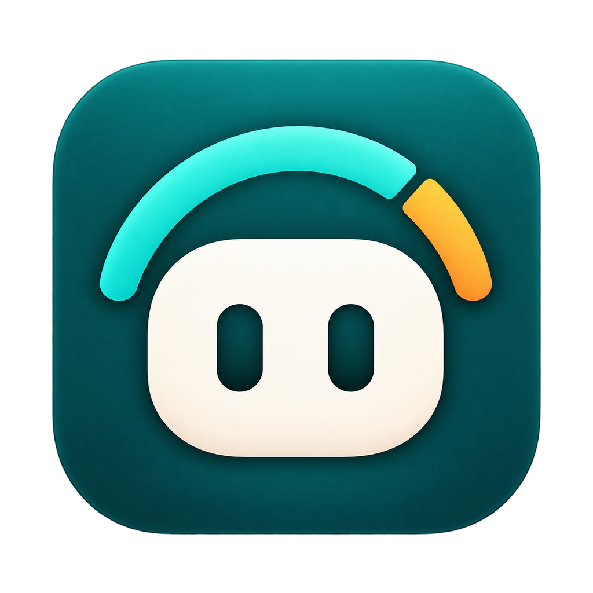
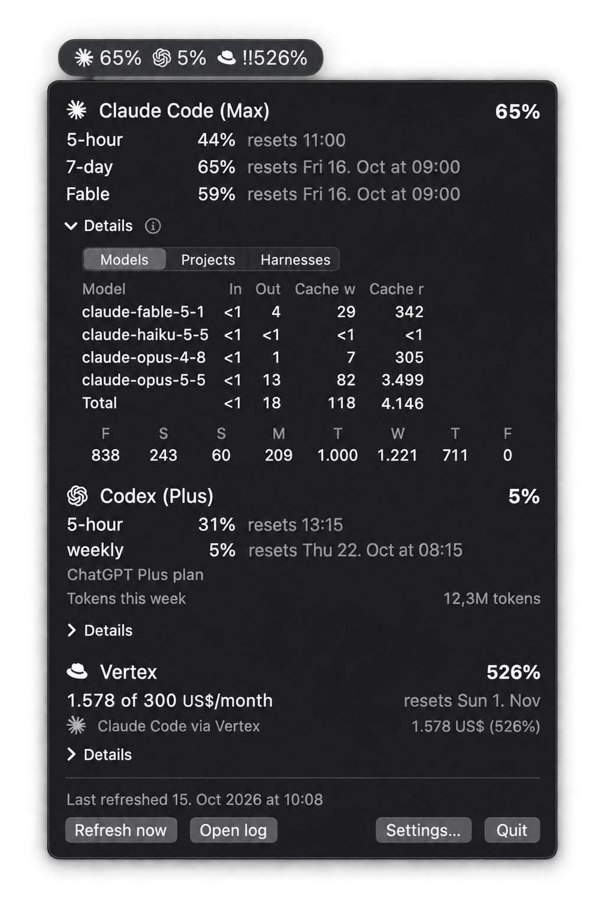

<h1>AgentMeter<br><sub><sup>Every agent, every plan, one menu bar</sup></sub></h1>

A macOS menu bar app that shows how much of your coding-agent usage limits you have used, across accounts with different pricing models.

<br clear="left">

<p align="center">
  
</p>

Each entry in the bar is an icon and a percentage. Click it for the details.

- **Subscription accounts** (Claude Code on a Claude Pro or Max plan) show the real 5-hour and 7-day utilization that Anthropic reports, plus model-specific weekly limits such as the one for Fable. The bar shows the 7-day window.
- **Token-based accounts** (Google Vertex AI or the OpenAI API) show spend in USD, computed from the local usage data of Claude Code, Codex and OpenCode with a built-in price table you can override, measured against a weekly or monthly budget you set. An account either has its own budget or belongs to a budget group. An account stands for who pays, not for a harness: a Vertex account collects Vertex usage from Claude Code and from OpenCode.
- **Codex subscription accounts** (Codex on a ChatGPT plan) show the plan's limits: every window of the plan (for example 5-hour and weekly on Plus, 30-day on Free) with its percent and reset time. The bar shows the longest window. The limits come live from the ChatGPT usage service, so usage on other machines and in the cloud counts too. When the service cannot be reached, or the Codex sign-in has expired, the last limits Codex recorded on this Mac are shown, marked stale. The dropdown also lists the tokens used through the plan this week, with the same breakdown.
- **Budget groups** put one or more token-based accounts under one shared budget, either weekly or monthly. A weekly budget lines up with your subscription's 7-day reset, or with a weekday and hour you choose. A monthly budget runs from midnight on the 1st to the end of the calendar month in local time, which suits a company spending limit granted per month.
- **Member shares.** A group member can also appear in the bar on its own, showing its spend as a percent of the group budget. It sits right after its group, or in the group's place when the group itself is hidden.
- The dropdown lists every account and group with its reset time, a per-model breakdown and a per-day trend. macOS notifications fire once when usage crosses one of your thresholds.

In the bar, `⚠` marks an entry at or above its lower notification threshold (80% by default), `‼` marks 100% or more, and `~` marks a value that could not be refreshed and may be out of date.

## Status

A personal project, built for my own setup and shared as is. It runs on macOS 14 or newer with Apple Silicon and reads usage from three agent harnesses: Claude Code, Codex and OpenCode.

AgentMeter is not affiliated with Anthropic, OpenAI, Google or the OpenCode project. The subscription percentages come from an undocumented Anthropic endpoint that Claude Code itself uses (`/api/oauth/usage`). It can change or disappear without notice, and then the subscription rows show an error while token-based accounts keep working. The same goes for the ChatGPT usage service behind the Codex plan limits (`/backend-api/wham/usage`); when it changes, Codex subscription accounts fall back to the limits recorded in the local Codex sessions.

## Installation

AgentMeter needs macOS 14 or newer on Apple Silicon.

**Download.** Get `AgentMeter-X.Y.Z.dmg` from the [latest release](https://github.com/rhuss/agentmeter/releases/latest), open it and drag AgentMeter onto the Applications folder.

**Homebrew.**

```bash
brew install --cask rhuss/tap/agentmeter
brew upgrade --cask agentmeter              # install a newer release
brew uninstall --zap --cask agentmeter      # remove the app, its configuration and its logs
```

**First launch after each install or upgrade.** Releases are signed with a self-signed certificate and are not notarized by Apple, so macOS blocks the first start of every new version until you allow it:

- macOS 14: Control-click AgentMeter in Applications and choose Open.
- macOS 15 or later: open AgentMeter, then choose "Open Anyway" in System Settings > Privacy & Security.
- Or run `xattr -dr com.apple.quarantine /Applications/AgentMeter.app` in a terminal.

The release notes say whether a release is notarized. A notarized release opens without these steps.

Run only one copy of AgentMeter at a time. If you built it yourself, quit that copy before you start the installed one. `brew upgrade` quits a running AgentMeter before the upgrade and opens it again afterwards; for a release that is not notarized, allow the new version once as described above. To upgrade from a DMG, quit AgentMeter, replace it in Applications and open it again. Notification permission and start at login carry over to upgrades signed with the same certificate.

## Build and run

Requirements: macOS 14 or newer on Apple Silicon, and the Xcode Command Line Tools with Swift 5.10 or newer. There are no third-party Swift packages.

```bash
make test     # unit tests for the UsageCore library (Swift Testing)
make app      # builds build/AgentMeter.app, signed with the best available identity
make run      # builds and opens the app
```

Run the app bundle rather than `swift run`, because notifications and start at login need an application bundle.

`make app` signs with a Developer ID certificate if there is one, otherwise with the self-signed "AgentMeter Signing" certificate (see [Releasing](#releasing-maintainer)), otherwise ad-hoc. It prints the version and the signing tier it used. With an ad-hoc signature, macOS treats every rebuild as a new app, so notification permission and start at login are lost after each build. `make app SIGN_IDENTITY=-` forces an ad-hoc signature.

On first launch, AgentMeter creates a configuration with one subscription account if Claude Code is signed in with the default configuration directory `~/.claude`. If you run Claude Code with a different directory (for example through `CLAUDE_CONFIG_DIR`), set that directory as the account's credential directory in Settings.

## Configuration

Everything lives in one JSON file, `~/.config/agentmeter/config.json`. The settings window (dropdown, "Settings…") writes it, and you can edit it by hand. The app picks up changes at the next refresh. If the file is invalid, the dropdown says so and the last valid configuration stays active.

```json
{
  "version": 1,
  "refreshIntervalSeconds": 300,
  "codexHomes": [],
  "openCodeDirectories": [],
  "accounts": [
    { "id": "acc-max", "type": "subscription", "icon": "brands:claude",
      "displayName": "Claude Max", "credentialDirectory": "~/.claude",
      "shownInBar": true, "thresholds": [80, 100] },
    { "id": "acc-vertex", "type": "tokenBased", "icon": "brands:google",
      "displayName": "Claude Code via Vertex", "provider": "vertex",
      "groupId": "grp-vertex", "shownInBar": false },
    { "id": "acc-own", "type": "tokenBased", "icon": "brands:google",
      "displayName": "Personal Vertex", "provider": "vertex",
      "budget": { "period": "monthly", "budgetUSD": 100, "shownInBar": true, "thresholds": [80, 100] } },
    { "id": "acc-oai", "type": "tokenBased", "icon": "brands:openai",
      "displayName": "OpenAI API", "provider": "openai",
      "budget": { "period": "monthly", "budgetUSD": 50, "shownInBar": true, "thresholds": [80, 100] } },
    { "id": "acc-codex", "type": "codexSubscription", "icon": "brands:openai",
      "displayName": "ChatGPT Plus", "codexHome": "~/.codex",
      "shownInBar": true, "thresholds": [80, 95], "liveLimits": true }
  ],
  "groups": [
    { "id": "grp-vertex", "name": "Vertex", "icon": "solid:wallet",
      "period": "monthly", "budgetUSD": 400, "shownInBar": true, "thresholds": [80, 100] }
  ]
}
```

The optional `arrangement` key holds the order of the bar and the dropdown: `entries` lists the top-level entries as `{ "kind": "account" | "group", "id": "..." }`, and `members` maps each group id to its member account ids in order. The key is absent until you first change the order (or add, move or remove an account or group in a way that affects it); until then the bar shows accounts first, then groups. Unknown or misplaced ids are ignored and missing entries are added at the end, so a hand edit never makes the file invalid.

The settings window has five tabs:

- **General**: refresh interval (default 5 minutes, minimum 1 minute), which subscription account sets the weekly window, the fallback weekday and hour (both apply to weekly budgets, of groups or of accounts with their own budget, and to Unassigned only), start at login, and extra locations to read: Claude Code directories, Codex homes and OpenCode data directories.
- **Menu Bar**: the order of the bar entries, which the dropdown sections follow too, with a live preview of the bar. Drag a row, or select it and use Move Up and Move Down (Option-Command-Up and Option-Command-Down Arrow). A group's members are listed under it and move with it; they can be reordered only within their group. Each row has a "Show in bar" checkbox, the same setting as the toggle in the account or group editor.
- **Accounts**: display name, icon, the credential directory for subscription accounts, the Codex home, whether the account shows in the bar, notification thresholds (checked for every plan window) and live limits for Codex subscription accounts, and an optional custom marker for telling apart two accounts of the same kind. A token-based account has a provider (Vertex or OpenAI) and a budget: either its own (period, amount, whether it shows in the bar, notification thresholds) or a budget group. A group member can show its share of the group budget in the bar.
- **Groups**: name, icon, period (weekly or monthly) and budget, whether the group shows in the bar, and notification thresholds.
- **Prices**: prices in USD per million tokens, with their source, your own overrides and extra models, and an Import menu (see [Prices](#prices)).

Every account and group has one [Font Awesome Free](https://fontawesome.com) icon, chosen from a searchable picker. New entries start with a default: the Claude icon for subscriptions, the Google icon for Vertex accounts, the OpenAI icon for OpenAI and Codex subscription accounts, and a wallet for groups. Several entries may share an icon; the dropdown and settings show each icon next to its name. Older configuration files with text labels still load: the labels are ignored and entries without an icon get the default.

## How it works

- **Claude Code.** AgentMeter reads Claude Code's session files under `~/.claude/projects` and any extra directories you configure. After the first scan it only rereads files that changed. A request id starting with `req_vrtx_` marks a Vertex session; other `req_` ids are direct Anthropic sessions.
- **Codex.** AgentMeter reads the rollout files under `~/.codex/sessions` and any extra Codex homes. Usage is the change of each session's running token total, so repeated events never count twice. A session whose rate-limit snapshot names a ChatGPT plan counts for the Codex subscription account (a subagent follows its parent session); every other session is API-key usage and counts for the OpenAI account. The same rate-limit snapshots supply the fallback for the plan limits.
- **Codex plan limits.** With live limits on (the default), AgentMeter reads the access token from `auth.json` in the account's Codex home at each refresh and asks the ChatGPT usage service for the plan's current limits, as Codex itself does. It never refreshes that sign-in: only Codex renews it while it runs. If the token has expired, or the service has already rejected it (a manual refresh tries a rejected token once more), AgentMeter makes no request and shows the newest snapshot, with a note to run Codex. Redirects are refused, so the token only ever goes to that one address. With live limits off, AgentMeter neither reads the sign-in nor contacts the service, and shows only the newest snapshot.
- **OpenCode.** AgentMeter reads `~/.local/share/opencode/opencode.db` (and any extra data directories) read-only, and after the first read only messages that changed. Each completed assistant message counts once. Its provider decides the account: `google-vertex` goes to Vertex, `openai` to OpenAI, anything else to Unassigned unless a custom marker claims it. OpenCode's own cost estimate is ignored. If the database is busy, the previous OpenCode values stay, marked stale.
- **Breakdowns.** Every account, group and Unassigned entry can show its usage per model, per project or per harness.
- **Prices.** The built-in table is in `Sources/UsageCore/Resources/prices.json`, and imported prices and your overrides are layered on top of it (see [Prices](#prices)). A model without a price is counted as unpriced, and the total of its budget (a group or an own budget) is marked incomplete until you add a price.
- **Subscription limits.** At each refresh, AgentMeter reads Claude Code's stored login from the macOS keychain through Apple's `/usr/bin/security` tool, and asks Anthropic's usage endpoint for the current utilization. Claude Code's keychain items already trust that tool, so no keychain dialog appears.

## Prices

Spend is computed from token counts and a price table in USD per million tokens. Each model's price comes from the first of these layers that has it:

1. **Manual**: prices you enter or override on the Prices tab (stored in `config.json`).
2. **CSV**: the prices of the last CSV file you imported.
3. **Provider imports**: Anthropic, OpenAI or Google Gemini prices from LiteLLM. When two of them price the same model, the more recent import wins.
4. **Built-in**: the table shipped with the app.

The **Import** menu on the Prices tab offers:

- **Anthropic prices (LiteLLM)**, **OpenAI prices (LiteLLM, direct and Vertex)** and **Google Gemini prices (LiteLLM)**. These download LiteLLM's public price list ([`model_prices_and_context_window.json`](https://github.com/BerriAI/litellm/blob/main/model_prices_and_context_window.json)) once, when you choose the item. Nothing is fetched in the background.
- **From CSV file…** reads a CSV file with a header row. `model`, `input` and `output` are required; `cache_write_5m`, `cache_write_1h` and `cache_read` are optional and default to 1.25, 2 and 0.1 times the input price. Commas or semicolons work as separators, and with semicolons a decimal comma (`2,50`) is accepted too. Files larger than 5 MB are rejected. A new CSV import replaces the previous one. The full format is in [`specs/002-price-import/contracts/price-csv.md`](specs/002-price-import/contracts/price-csv.md).
- **Export current prices as CSV…** writes the effective table in the same format, so you can edit it in a spreadsheet and import it again.
- **Remove … prices** for each stored import, after a confirmation that says how many models fall back to another price.

Every import shows a preview first: new, changed, removed and shadowed models (a shadowed model keeps a higher-ranked price, such as your override), plus skipped CSV rows with their line numbers. Nothing changes until you choose Apply. Applying or removing an import re-prices the session logs right away without asking Anthropic's usage endpoint again.

The table shows each row's source and, by default, only the models used in the current window plus your overrides; switch the filter to **All** to see every model. Imported prices are stored in `~/.config/agentmeter/imported-prices.json`, one batch per import kind.

## Privacy

- AgentMeter only reads Claude Code's session logs and keychain items, Codex's session logs, Codex's `auth.json` (for Codex subscription accounts with live limits on; when it is missing, one setting in Codex's `config.toml` that says whether Codex keeps its sign-in in the keychain) and OpenCode's database. It never writes to them, never opens OpenCode's credential files, and never refreshes or changes your login.
- The regular network requests go to `api.anthropic.com` with your own token, to fetch your Claude usage, and, for Codex subscription accounts with live limits on, to `chatgpt.com/backend-api/wham/usage` with the Codex token, to fetch the plan's limits. A provider price import downloads LiteLLM's price list from `raw.githubusercontent.com`, without credentials, only when you choose it from the Import menu. There is no telemetry and no other server.
- Tokens stay in memory for the duration of one request. They are not written to the configuration, the log, notifications, or any other file.
- A diagnostic log at `~/Library/Logs/agentmeter/usage.log` (capped at 5 MB) records one line per refresh with percentages, spend totals and errors, but never credentials. "Open log" in the dropdown shows it.

## Development

- `Sources/UsageCore`: all logic (configuration, log parsing, pricing, attribution, weekly windows, aggregation, thresholds, icon catalog), with no UI code.
- `Sources/AgentMeter`: the SwiftUI menu bar app.
- `Tests/UsageCoreTests`: Swift Testing suites with small synthetic session-log fixtures.
- `scripts/sum-vertex.sh <start> <end> [dir...]`: recomputes Vertex spend for a window with `jq`, as an independent check of the app.
- `scripts/build-icon-catalog.sh`: regenerates the bundled Font Awesome files from a pinned release, with an integrity check.
- `scripts/release/`: the build, DMG, release and cask scripts behind `make app`, `make dmg`, `make release` and `make cask`. `make test-release` runs their tests, which use stubs and local repositories and publish nothing.
- `specs/001-agentmeter` and `docs/superpowers/specs`: the specification, plan and design notes the app was built from.

## Releasing (maintainer)

### Signing certificate (once)

Releases and local builds are signed with a self-signed code-signing certificate named "AgentMeter Signing", so macOS recognizes each new build as the same app. Create it once in Keychain Access:

1. Choose Keychain Access > Certificate Assistant > Create a Certificate.
2. Enter the name `AgentMeter Signing` exactly (no space; the build matches the name exactly and otherwise falls back to ad-hoc signing), choose Identity Type "Self Signed Root" and Certificate Type "Code Signing", and select "Let me override defaults".
3. Set the validity period to 3650 days (10 years). Keep the key pair at RSA, 2048 bits. Under Key Usage, check only "Signature"; under Extended Key Usage, keep "Code Signing". Leave Basic Constraints unchecked, uncheck Subject Alternative Name (checked by default, but code signing does not use it), and store the certificate in the login keychain.
4. Open the new certificate in the login keychain, expand Trust and set "Code Signing" to "Always Trust".

`make app` then prints `signing: self-signed (AgentMeter Signing)`. To look up a certificate with another name, pass `SIGN_IDENTITY_NAME="Other name"`. The tier `self-signed` stands for any certificate that is not a Developer ID Application certificate, so a build signed with, for example, an "Apple Development" certificate through `SIGN_IDENTITY` is also reported, released and described in the notes as `self-signed`.

To sign on a second Mac or a CI runner, export the certificate together with its private key as a `.p12` file (select both in Keychain Access, then File > Export Items, and set an export password) and import it there. Both commands ask for their password, so no password ends up on the command line or in the shell history:

```bash
security import AgentMeter-Signing.p12 -k ~/Library/Keychains/login.keychain-db \
  -T /usr/bin/codesign                  # asks for the .p12 export password in a dialog
security set-key-partition-list -S apple-tool:,apple: -s \
  ~/Library/Keychains/login.keychain-db # asks for the login keychain password in the terminal
rm AgentMeter-Signing.p12               # the private key is in the keychain now
```

The second command lets `codesign` use the key without a keychain prompt, which a release without a terminal needs. Delete the `.p12` file after the import (or keep it only in a password manager or vault): anyone with the file and its password can sign builds that macOS treats as AgentMeter. A CI runner has to pass both passwords non-interactively (`-P` and `-k`); take them from the runner's secret store, never from a value typed into a command.

### Developer ID and notarization (optional)

With a "Developer ID Application" certificate in the keychain, every build uses it instead, with the hardened runtime and a secure timestamp. To notarize releases, store the notarization credentials once under the profile name `agentmeter-notary`:

```bash
xcrun notarytool store-credentials agentmeter-notary \
  --apple-id you@example.com --team-id TEAMID
```

A release then submits the DMG to Apple, staples the ticket and uses the DMG background and cask caveats without first-launch steps. Without the profile, a Developer ID release is published as "Developer ID, not notarized" with a warning. If the profile exists but cannot be checked (no network, expired credentials), the release stops before building. Users have to allow notifications and start at login once more after the first release on a new signing tier.

### Publishing a release

```bash
make dmg                                     # dry run, works on any commit
git tag vX.Y.Z && git push origin vX.Y.Z
make release
```

`make dmg` builds `build/release/AgentMeter-<version>.dmg` and its checksum without publishing anything. Untagged or uncommitted builds get a development version such as `0.2.0-dev`, and preflight problems only print warnings.

`make release` checks first and stops before building when the working tree has uncommitted changes, the repository is a shallow clone, HEAD has no `vX.Y.Z` tag, the tag is not on `origin` at the same commit, `gh` is not logged in, the GitHub release already exists, only an ad-hoc signature is available, or the tap repository cannot be reached. It then builds and signs the app, creates the DMG, notarizes it when possible, creates a draft GitHub release, uploads the DMG, its `.sha256` file and `release-info.json`, publishes the release and updates the `agentmeter` cask in `rhuss/homebrew-tap`. Before the upload it checks that the checksum in `release-info.json` matches the final DMG. The cask moves only to the latest published release: replacing the assets of an older tag with `REPLACE=1` leaves it alone. If an upload fails, the release stays a draft and the output shows how to retry (`make release REPLACE=1`) or delete it. If the cask update fails after publishing, finish it with the command below, which refuses releases that are still drafts:

```bash
make cask VERSION=X.Y.Z
```

`make cask` downloads the release's DMG and stops when its checksum differs from `release-info.json`.

The release targets read these variables:

| Variable | Default | Meaning |
|---|---|---|
| `SIGN_IDENTITY` | automatic | Identity name or SHA-1 to sign with; `-` forces ad-hoc |
| `SIGN_IDENTITY_NAME` | `AgentMeter Signing` | Name of the self-signed certificate |
| `NOTARY_PROFILE` | `agentmeter-notary` | `notarytool` keychain profile |
| `ALLOW_ADHOC` | unset | `1` allows publishing an ad-hoc signed release |
| `REPLACE` | unset | `1` replaces the assets of an existing release |
| `TAP_REPO` | `git@github.com:rhuss/homebrew-tap.git` | Tap repository; override for testing only |
| `GH_REPO` | `rhuss/agentmeter` | GitHub repository of the app; override for testing only |
| `VERSION` | required for `make cask` | Version of an already published release |

`TAP_REPO` and `GH_REPO` exist so tests and trial runs can point at a scratch tap or repository. The cask's download URL and the `brew install` command in the release notes always name `rhuss/agentmeter` and `rhuss/tap`, whatever these variables say.

The DMG backgrounds in `Resources/dmg/` are generated by `make backgrounds` and committed.

## Credits

The icons are [Font Awesome Free](https://fontawesome.com) 7.3.1 by Fonticons, Inc. The icons are licensed under CC BY 4.0, the fonts under SIL OFL 1.1, and the code under MIT. See `Sources/UsageCore/Resources/FontAwesome/LICENSE.txt`.

## License

Apache License 2.0, see [LICENSE](LICENSE). The bundled Font Awesome files keep their own licenses, listed above.

---

Author: Roland Huß [AIA PAI Nc Hin R Claude Opus 5.5 v1.0](https://aiattribution.github.io/statements/AIA-PAI-Nc-Hin-R-?model=Claude%20Opus%205.5-v1.0)
